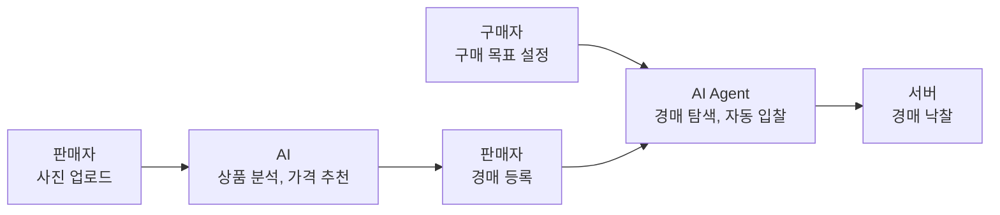
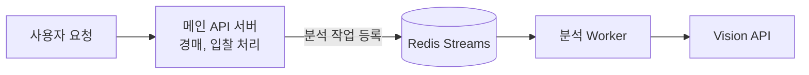

# Autique

```
AI가 상품 정보를 분석하고 시세 기반 가격 판단을 돕는 빈티지 신발 경매 플랫폼, Autique 🛍️
이화여자대학교 컴퓨터공학 전공의 졸업 프로젝트입니다.
```


## 📍 Problem

빈티지·중고 신발의 가격은 모델명만으로 정해지지 않습니다.

- **판매자**는 상태를 직접 판단하고, 여러 사이트의 가격을 비교해 판매가를 정해야 합니다.
- **구매자**는 매물마다 상태와 가격을 비교하며 적정가를 계속 판단해야 합니다.

이처럼 상태·구성품·희소성에 대한 정보 격차로 인해 같은 상품의 가치가 다르게 판단되고, 적정 가격이 제대로 형성되기 어렵습니다.


## 📍 Solution

- AI가 사진에서 상품 상태와 특징을 분석하고, 
- 이를 시세 데이터와 비교해 판매자와 구매자 모두에게 동일한 판단 근거를 제공합니다.
- 또한 경매를 통해 여러 구매자의 수요를 경쟁적으로 반영하여 시장 가치에 가까운 가격 형성합니다.


## 🏷️ User Flow

판매자는 사진만으로 쉽게 등록하고, 구매자는 조건만 정하면 Agent가 자동으로 입찰합니다.




## 🚀 Key Features

### 1️⃣ AI 상품 분석

신발 사진 여러 장을 올리면 상품 정보를 자동으로 추출합니다.

- **추출 항목**: 브랜드, 모델명, 색상, 사이즈, 상태 등급
- **분석 속도**: Vision 분석 평균 **11초**
  - 분석용 이미지를 768px로 축소
  - 분석 단계 3개를 병렬로 처리
  - 응답을 짧은 키워드 형식으로 제한
  - 모델 비교 후 Claude Sonnet 5 채택
- **사용자 검수**: AI 결과를 사용자가 확인한 뒤 확정하여 가격 산정에 반영

#### 비동기 분석 구조



- 분석 작업은 Redis Streams 기반의 별도 Worker가 처리하므로, 분석이 지연되어도 경매·입찰 요청에는 영향이 없습니다.
- **Worker 중단 시**: 미완료 작업을 다른 Worker로 넘겨 재처리하고, 이전 Worker가 늦게 반환한 결과는 차단합니다.
- **외부 API 과부하 시**: 실패 횟수에 포함하지 않고 재시도 기회를 유지합니다. 실제 분석 실패만 1회로 집계합니다.

### 2️⃣ 가격 엔진

기준 시세에 상태·구성품 계수를 적용해 추천가와 권장 가격 범위를 산출합니다.

- **실측 기반 상태 계수**: 국내 중고 매물 **1,884건**으로 등급별 계수 산정 (S등급 0.404, 새 제품 대비 약 40%)
- **구성품 계수**: 박스 없음 0.90
- **국내 시세 기준**: 해외(eBay) 시세는 섞으면 오차가 커져 기준 시세에서 제외
- **시세 제공 모델**: 65개
- **산정 근거 공개**: 참조한 거래 건수, 평균가, 반영 비율을 상품 화면에 함께 표시

### 3️⃣ 실시간 경매

- **입찰 방식**: 직접 입찰, 자동 입찰(상한가를 정하면 다른 입찰에 최소 단위로 자동 대응)
- **입찰 검증**: 최소 다음 입찰가, 최소 입찰 단위 확인
- **실시간 갱신**: 현재가, 최고 입찰자, 입찰 내역
- **경매 종료**: 종료 시각에 낙찰자와 최종 가격 확정

#### 동시 입찰 부하 테스트 (20~200 VU)

| 항목 | 결과 |
| --- | --- |
| 최종 가격 · 낙찰자 정합성 위반 | **0건** |
| 락 타임아웃 · 데드락 | **0건** |
| 요청 실패 없는 처리 구간 | **100 VU**까지 |

- 150 VU부터 일부 연결 거부가 발생했으며, 병목은 DB가 아닌 연결 처리 구간으로 확인했습니다. 
- 대기열을 늘리면 연결 거부는 41건에서 0건으로 줄었고, p95 응답 시간은 0.65초에서 1.98초로 늘었습니다.

### 4️⃣ 구매 Agent

경매 한 건에만 적용되던 자동 입찰을 **구매 목표 단위**로 확장했습니다.

```
"뉴발란스 530, A급 이상, 30만 원 이하"
  → 자연어 조건 해석 (Parser)
  → 서버 검증
  → 경매 탐색 · 적합도 판정 (규칙 기반 Matcher)
  → 자동 입찰로 참여
      ├─ 낙찰   → 구매 목표 종료
      └─ 미낙찰 → 다음 경매 재탐색
```

- **Matcher 정확도**: 실제 매물 59건 중 57건 판정 일치 (약 **97%**), 조건에 맞지 않는 상품 통과 **0건**
- **입찰 상한 제한**: `min(사용자가 확정한 예산, 서버 추정가 기준 한도)`
  - 판매자가 정한 시작가는 상한 계산의 기준으로 쓰지 않습니다.
- **결제 승인**: 낙찰 후 결제는 반드시 사용자가 직접 승인합니다.


## ⚙️ Teck Stack


## ⚒️ Devlopers

|김수연<br>[@mmaybei](https://github.com/mmaybei)|이예주<br>[@yeju321qaz](https://github.com/yeju321qaz)|조채윤<br>[@jchaeyun](https://github.com/jchaeyun)|
|:---:|:---:|:---:|
||||
|`UI/UX`, `FrontEnd`|`AI`|`BackEnd`|
